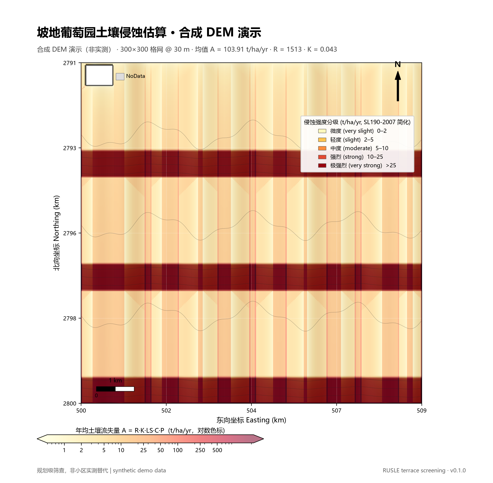

# rusle-terrace

从 DEM 出发，给坡地梯田葡萄园做规划级土壤侵蚀筛查：一条命令算出 RUSLE 的 A 值、强度分级、坡度分级统计、地图和中文报告。

[](https://github.com/uppercrusteve/rusle-terrace/actions/workflows/ci.yml)
[](LICENSE)
[](https://www.python.org/)
[](#测试)
[](docs/methods.md)



## 为什么做

坡地葡萄园的整地、行向和梯田维护决策经常只靠经验，缺一张能把“哪条坡、哪个坎脚最危险”摆到桌面上的图。商业 GIS 的 RUSLE 工具链重、参数藏在对话框里，跑完也很难留下可复核的口径。这个工具把 R/K/LS/C/P 的算式、单位、分级阈值和全部警告固定进代码与输出，让一次筛查可以复现、可以争论、可以改进。

它服务于研究流程里的**分析**环节，定位是规划级相对筛查，不是小区实测的替代品。

## 安装

需要 Python 3.10+。`rasterio` 依赖 GDAL：Linux 先装系统库，Windows 与 macOS 直接用预编译 wheel。

Windows PowerShell：

```powershell
py -3.12 -m venv .venv
.\.venv\Scripts\Activate.ps1
python -m pip install -e ".[dev]"
rusle --help
```

macOS：

```bash
brew install gdal
python3 -m venv .venv
source .venv/bin/activate
python -m pip install -e ".[dev]"
rusle --help
```

Linux（Debian/Ubuntu）：

```bash
sudo apt-get install -y gdal-bin libgdal-dev python3-venv
python3 -m venv .venv
source .venv/bin/activate
python -m pip install -e ".[dev]"
rusle --help
```

## 快速开始

仓库自带合成演示 DEM 与参数（**非实测**）。三条命令即可看到完整结果：

```bash
rusle demo -o demo_out
rusle run examples/demo/dem.tif examples/demo/params.yaml -o out
rusle factors --precip 620 --sand 45 --silt 35 --clay 20 --oc 1.2 --practice terraces
```

`demo` 生成并立即跑通全链路，实测输出：

```
Generated synthetic 300x300 @ 30 m south-facing terraced DEM (analytic slope 1.718-17.884 deg).
R = 1512.51   K = 0.0426   C mean = 0.250   P mean = 0.185
A (t/ha/yr): mean 103.908  median 8.218  P90 253.554  max 6931.329
NOTE: synthetic DEM - not observed data.
```

`run` 接受任意合规 DEM。`factors` 不需要 DEM，只打印 R、K 和分坡度 P 值，方便先核对参数。

## 输入格式与输出

### DEM

单波段 GeoTIFF，**必须是米制投影 CRS**（如 EPSG:32647），方形像素、正向分辨率。以下情况会报错并以退出码 2 结束：

- 没有 CRS / 地理坐标系（EPSG:4326）
- 线性单位不是米（如美国测量英尺 EPSG:2225）
- 多波段、非方形像素、不支持的数据类型
- 文件不存在

经纬度 DEM 请先 `gdalwarp -t_srs EPSG:32647 -tr 30 30` 重投影；程序不做内部重投影。高程假定为米。

### 参数文件

UTF-8 YAML，六个必填键（`slope_classes_deg` 可选）：

| 键 | 含义 | 单位 / 范围 |
| --- | --- | --- |
| `annual_precip_mm` | 年降水量 | mm，> 0 |
| `sand_pct` / `silt_pct` / `clay_pct` | 砂 / 粉 / 黏粒 | %，三者合计 100 ± 1 |
| `organic_carbon_pct` | 有机碳 | %，0–100 |
| `cover_factor` | 覆盖因子 C 标量 | 0–1 |
| `support_practice` | 措施 | `none` / `contour` / `terraces` |
| `slope_classes_deg` | 坡度分级（可选） | 从 0 起、严格递增、终于 ≥90 |

```yaml
annual_precip_mm: 620
sand_pct: 45
silt_pct: 35
clay_pct: 20
organic_carbon_pct: 1.2
cover_factor: 0.25
support_practice: terraces
slope_classes_deg: [0, 5, 10, 15, 25, 90]
```

可选 `--c-factor-raster c.tif` 用与 DEM 同网格的 0–1 栅格替代标量 C；可选 `--p-factor 0.4` 用标量覆盖 P 表。

### 输出

每次 `run` 在 `-o` 目录写出：

| 文件 | 内容 |
| --- | --- |
| `erosion.tif` | float32 GeoTIFF，NoData = −9999，A 值 t/ha/yr |
| `erosion-map.png` | 山体阴影 + 对数色标 + 强度图例 + 比例尺 + 指北针 |
| `slope-class-stats.csv` | 逐坡度分级面积、均值、P90、按均值定的等级 |
| `summary.json` | schema 1.0 元数据：合成/外部标签、CRS、参数、R/K/C/P、分位数、强度面积占比、warnings |
| `report.md` | 中文报告：参数、因子、分级表、警告、复现命令 |

`summary.json` 与报告固定写入“未填洼”“C/P 需本地率定”“非小区实测替代”三条警告；合成 DEM 和梯田模式会追加对应警告。合成判定读取 DEM 同目录的 `dem_truth.json`，不靠文件名。

## 方法与局限

主式 `A = R·K·LS·C·P`。R 用 Renard & Freimund (1994) 年降水回归；K 用 EPIC（Williams, 1995）并换算为 SI；LS 由 D8 单位汇水面积计算（m = 0.5, n = 1.3）；C 为标量或栅格；P 按坡度查表。强度分级为 SL190-2007 水力面蚀分级的简化。

**关键局限**：

- **不填洼**。D8 在洼地与平地截断汇流，上游来水被低估；运行前应先填洼。
- **C/P 未经本地小区实测率定**。默认值和查表值只能排序，绝对量不可直接申报。
- LS 是单流向近似，无上坡面积上限，固定 m/n 不随坡度调整；陡坡可能低估。
- 30 m 像元分辨不出台坎，坎脚侵蚀带被摊平；需要坎脚细节时用 ≤ 10 m DEM，并固定同一分辨率做比较。
- 台地几何本身不进入 DEM 修正，只在 P 上打折；P 假设梯田完好、连续、全覆盖。
- 结果不含沟蚀、风蚀与单场暴雨。

完整公式、单位、出处、分辨率的定量影响和全部假设见 [`docs/methods.md`](docs/methods.md)。

## 数据来源

`examples/demo/` 全部为**合成演示数据**：DEM 是由 `rusle demo` 按解析式生成的南向三级台地（300×300 @ 30 m，EPSG:32647），参数为占位值，两者都不代表任何真实地块。`dem_truth.json` 记录解析坡度真值（1.72–17.88°）供测试对照；`params.yaml` 首行注明未率定。

真实项目应在运行时换成自己的投影 DEM、本地降水、实测质地与有机碳，并用小区数据率定 C/P。

## 测试

```bash
python -m ruff check .
python -m pytest -q
```

69 个测试覆盖：R/K/P 公式手算值与越界、LS 对解析平面的 <5% 相对误差、D8 方向与汇流守恒、NoData 掩膜、CRS 与波段校验、CSV/JSON/Markdown 输出结构与合成标记、CLI 的 0 / 2 退出码与 `--help`。CI 在 Ubuntu 与 Windows、Python 3.11/3.12 上跑同一套。

## 引用

```bibtex
@software{rusle_terrace2026,
  author  = {uppercrusteve},
  title   = {rusle-terrace: RUSLE soil-erosion screening for terraced hillslope vineyards},
  year    = {2026},
  version = {0.1.0},
  url     = {https://github.com/uppercrusteve/rusle-terrace},
  license = {MIT}
}
```

机器可读版本见 [`CITATION.cff`](CITATION.cff)。方法涉及的原始文献列在 `docs/methods.md` 第 13 节。

## English summary

rusle-terrace is a small command-line tool for planning-level RUSLE soil-erosion
screening on terraced hillslope vineyards. From a single-band metric GeoTIFF DEM
and a YAML parameter file it computes A = R·K·LS·C·P with D8-derived slope
length, then writes an erosion raster, hillshade map, slope-class statistics,
JSON summary and Chinese Markdown report. DEMs must use a projected metre CRS
with square pixels. C and P are literature values and require local plot
calibration; depressions are not filled and 30 m grids cannot resolve terrace
risers. The bundled demo DEM and parameters are synthetic. Formulas, units,
sources and limitations are in `docs/methods.md`.

## License

MIT © 2026 uppercrusteve. See [`LICENSE`](LICENSE).
